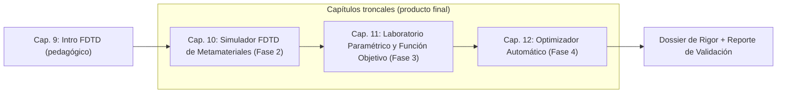
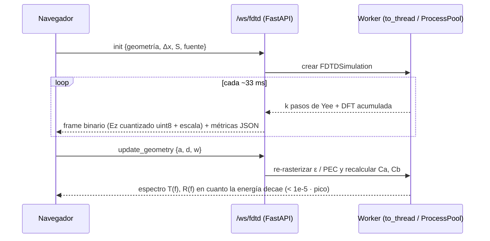

# Plan de Desarrollo — Capítulos Principales: Simulador FDTD de Metamateriales y Optimizador Automático

> **Objetivo (README, Fase 2 → 4):** *"Desarrollar un sistema computacional capaz de diseñar y optimizar una estructura electromagnética para controlar la propagación de ondas electromagnéticas."*
>
> Los capítulos 1–9 son la **escalera pedagógica**. Este plan define los **capítulos troncales 10, 11 y 12**, que son el producto final, y la **evidencia verificable** de que el código del dominio tiene rigor físico y calcula en tiempo real.

---

## 0. Diagnóstico del estado actual (lo que hay que corregir antes)

Revisé [fdtd2d.py](file:///electromagnetismo/backend/domain/fdtd2d.py), [metamaterials.py](file:///electromagnetismo/backend/domain/metamaterials.py) y [realtime_physics.py](file:///electromagnetismo/backend/api/websockets/realtime_physics.py). Hay problemas que un jurado técnico podría notar:

| # | Problema | Dónde | Por qué importa |
|---|---|---|---|
| D1 | `T(f)` se normaliza con **el pico de su propio espectro** y no con la onda incidente | [compute_transmission_spectrum](file:///electromagnetismo/backend/domain/fdtd2d.py#L211-L234) | El resultado **no es la transmisión física**. Una lámina con 30 % de pérdidas también daría pico = 1 |
| D2 | Las filas `Ez[:,0]` y `Ez[:,-1]` nunca se actualizan → **paredes PEC implícitas** en y | [step](file:///electromagnetismo/backend/domain/fdtd2d.py#L176-L183) | El dominio es una guía de placas paralelas, no una onda plana sobre un arreglo periódico infinito |
| D3 | La fuente está recortada a `[10:-10]` | [step](file:///electromagnetismo/backend/domain/fdtd2d.py#L187) | Genera difracción en los bordes del frente de onda |
| D4 | No existe onda de referencia, así que **R(f) no se puede medir** | — | No se puede comprobar `R+T=1` |
| D5 | `R+T+A=1` se cumple **por construcción** (`A = 1−T−R` más renormalización si la suma pasa de 1) | [compute_spectral_response](file:///electromagnetismo/backend/domain/metamaterials.py#L184-L193) | La verificación es **tautológica**: nunca puede fallar |
| D6 | `f₀m` sale de una fórmula **calibrada a mano**, no derivada | [magnetic_resonance_frequency](file:///electromagnetismo/backend/domain/metamaterials.py#L56-L69) | Sirve como modelo pedagógico, pero no puede ser la "fuente de verdad" del optimizador |
| D7 | `verify_bragg_bandgap` → `is_verified = theo > 0` | [L314](file:///electromagnetismo/backend/domain/metamaterials.py#L314) | Tautológico |
| D8 | `is_all_verified` del capítulo 9 usa `theoretically_stable` en vez de `numerically_stable` | [L533](file:///electromagnetismo/backend/api/websockets/realtime_physics.py#L533) | La prueba no prueba la simulación |
| D9 | El cálculo CPU-intensivo corre **dentro del event loop** del WebSocket | `realtime_physics.py` | Un optimizador de minutos bloquearía todo el servidor |
| D10 | La geometría del arreglo FDTD está fija (`y in range(8, Ny-8, 8)`) y no está parametrizada en `(a, d, w)` | [add_metamaterial_periodic_array](file:///electromagnetismo/backend/domain/fdtd2d.py#L112-L128) | No se puede conectar con la Fase 3/4 |

> [!IMPORTANT]
> **Decisión de diseño central:** en los capítulos troncales, **el FDTD es la única fuente de verdad** para `T(f)`, `R(f)` y la función objetivo. El modelo Drude-Lorentz/TMM del capítulo 8 queda como modelo pedagógico de medio efectivo. El TMM **exacto** (lámina y multicapa) se reutiliza como **referencia analítica** para validar el FDTD.

---

## 1. Visión de los capítulos troncales



| Capítulo | Fase del README | Qué entrega | Prueba de rigor principal |
|---|---|---|---|
| **10 — Simulador FDTD** | Fase 2 (§1–5) | Motor FDTD v2: onda plana sobre una celda periódica, CPML, TF/SF, monitores DFT, T(f) y R(f) físicos | 3 casos de validación + convergencia O(Δx²) |
| **11 — Laboratorio paramétrico** | Fase 3 | Barridos `(a, d, w, f)`, dataset, familia de curvas T(f), mapas de calor y función objetivo F | Estabilidad de F frente a refinamiento de malla |
| **12 — Optimizador** | Fase 4 + "Producto final" | Búsqueda sistemática + algoritmo genético con progreso en vivo y re-validación del mejor diseño | El GA alcanza el óptimo de la búsqueda exhaustiva con menos evaluaciones |

---

## 2. Fundamento físico y numérico (lo que se debe poder explicar)

### 2.1 Ecuaciones de Maxwell → modo TM 2D

Medio lineal, isótropo y sin dispersión: `D = εE`, `B = μ₀H`, `J = σE`. Si ∂/∂z = 0 y la polarización es `E = Ez ẑ`:

$$
\frac{\partial H_x}{\partial t} = -\frac{1}{\mu_0}\frac{\partial E_z}{\partial y},\qquad
\frac{\partial H_y}{\partial t} = \frac{1}{\mu_0}\frac{\partial E_z}{\partial x},\qquad
\varepsilon\frac{\partial E_z}{\partial t} + \sigma E_z = \frac{\partial H_y}{\partial x} - \frac{\partial H_x}{\partial y}
$$

### 2.2 Discretización de Yee (salto de rana, 2.º orden en espacio y tiempo)

$$
H_x\big|^{n+\frac12}_{i,j+\frac12} = H_x\big|^{n-\frac12}_{i,j+\frac12} - \frac{\Delta t}{\mu_0\Delta y}\left(E_z\big|^{n}_{i,j+1}-E_z\big|^{n}_{i,j}\right)
$$
$$
H_y\big|^{n+\frac12}_{i+\frac12,j} = H_y\big|^{n-\frac12}_{i+\frac12,j} + \frac{\Delta t}{\mu_0\Delta x}\left(E_z\big|^{n}_{i+1,j}-E_z\big|^{n}_{i,j}\right)
$$
$$
E_z\big|^{n+1}_{i,j} = C_a E_z\big|^{n}_{i,j} + C_b\left[\frac{H_y|_{i+\frac12,j}-H_y|_{i-\frac12,j}}{\Delta x} - \frac{H_x|_{i,j+\frac12}-H_x|_{i,j-\frac12}}{\Delta y}\right]^{n+\frac12}
$$
$$
C_a=\frac{1-\frac{\sigma\Delta t}{2\varepsilon}}{1+\frac{\sigma\Delta t}{2\varepsilon}},\qquad C_b=\frac{\Delta t/\varepsilon}{1+\frac{\sigma\Delta t}{2\varepsilon}}
$$

### 2.3 Estabilidad CFL y dispersión numérica

$$
S=\frac{c\,\Delta t}{\Delta}\le\frac{1}{\sqrt2}\quad(\text{2D, }\Delta x=\Delta y)
$$

**Relación de dispersión numérica de Yee** (Taflove, cap. 4). Esta fórmula permite predecir *exactamente* la velocidad que debe medir el simulador, no solo "≈ c":

$$
\left[\frac{\sin(\omega\Delta t/2)}{c\,\Delta t}\right]^2=\left[\frac{\sin(\tilde k_x\Delta x/2)}{\Delta x}\right]^2+\left[\frac{\sin(\tilde k_y\Delta y/2)}{\Delta y}\right]^2
\;\Rightarrow\;
\tilde v_p=\frac{\omega}{\tilde k_x},\;\tilde k_x=\frac{2}{\Delta x}\arcsin\!\left(\frac{\Delta x}{c\Delta t}\sin\frac{\omega\Delta t}{2}\right)
$$

### 2.4 Celda unitaria periódica (Floquet-Bloch, incidencia normal)

Con incidencia normal y periodo `a` en y: `E(x, y+a) = E(x, y)`. Basta simular **una sola celda** en la dirección transversal, con fronteras periódicas. Esto representa un arreglo **infinito** y reduce el dominio entre 10 y 50 veces, lo que hace viable el optimizador.

Límite de validez del orden cero (sin órdenes de difracción propagantes):

$$
f < f_{\text{dif}} = \frac{c}{a}\quad(a=10\text{ mm}\Rightarrow 30\text{ GHz};\ a=20\text{ mm}\Rightarrow 15\text{ GHz})
$$

> [!WARNING]
> Con `a` hasta 20 mm (rango del README), el borde de 15 GHz coincide con la aparición de difracción. Propongo usar `a ≤ 19 mm` o calcular `T` y `R` por **flujo de Poynting**, que suma todos los órdenes (§2.6).

### 2.5 Fronteras absorbentes CPML (Roden & Gedney, 2000) en x

$$
\psi^{n+1}=b\,\psi^{n}+a\,\frac{\partial F}{\partial x},\quad
b=e^{-(\sigma_x/\kappa_x+\alpha_x)\Delta t/\varepsilon_0},\quad
a=\frac{\sigma_x}{\sigma_x\kappa_x+\kappa_x^2\alpha_x}(b-1)
$$
$$
\sigma_x(\rho)=\sigma_{\max}\left(\frac{\rho}{d}\right)^m,\quad m=3,\quad \sigma_{\max}\approx\frac{0.8(m+1)}{\eta_0\Delta x}
$$

Sustituye a Mur de 1er orden. Objetivo: **R < −40 dB**. Mur se mantiene como comparación educativa.

### 2.6 Fuente TF/SF, monitores DFT y definición física de T y R

- **Fuente:** pulso gaussiano modulado, sin componente DC, que cubre de 5 a 15 GHz:
  $E_{inc}(t)=e^{-((t-t_0)/\tau)^2}\sin(2\pi f_c (t-t_0))$.
- **TF/SF (Total-Field/Scattered-Field):** una rejilla auxiliar 1D genera el campo incidente **con la misma dispersión numérica** que la 2D. A la izquierda de la frontera solo queda el campo reflejado. Por eso **R se mide directamente**, sin restar dos simulaciones.
- **DFT en línea**, sin guardar el historial completo:
  $\tilde E(f_k)=\sum_n E^n e^{-i2\pi f_k n\Delta t}\Delta t$.
- **Transmisión y reflexión por flujo de Poynting** (para TM, $S_x=-E_zH_y$):
$$
P(f)=\tfrac12\,\mathrm{Re}\sum_j\left[-\tilde E_z(f)\,\tilde H_y^*(f)\right]\Delta y,\qquad
T(f)=\frac{P_{t}(f)}{P_{inc}(f)},\quad R(f)=\frac{-P_{r}(f)}{P_{inc}(f)},\quad A=1-R-T
$$

> [!NOTE]
> Aquí **R y T se miden de forma independiente**. Por eso `R+T=1` en un medio sin pérdidas **es una prueba real que puede fallar**, a diferencia de D5.

### 2.7 Soluciones analíticas de referencia (benchmarks)

| Caso | Fórmula exacta | Uso |
|---|---|---|
| Lámina dieléctrica (Airy / Fabry-Pérot) | $T=\left[1+\tfrac14\left(n-\tfrac1n\right)^2\sin^2(nk_0L)\right]^{-1}$, picos en $f_m=\frac{mc}{2nL}$ | Caso 2 del README |
| Multicapa / espejo de Bragg (TMM) | $M_j=\begin{pmatrix}\cos\delta_j & -\tfrac{i}{n_j}\sin\delta_j\\ -in_j\sin\delta_j & \cos\delta_j\end{pmatrix},\ t=\frac{2}{M_{11}+M_{12}+M_{21}+M_{22}}$, ancho de banda $\frac{\Delta f}{f_0}=\frac4\pi\arcsin\frac{n_H-n_L}{n_H+n_L}$ | Estructura periódica 1D exacta |
| Medio de hilos PEC (Pendry 1996; Belov 2002) | $(k_pa)^2=\dfrac{2\pi}{\ln\frac{a}{2\pi r}+0.5275}$, opaco para $f<f_p$ | Para a=10 mm y r=0.5 mm, f_p ≈ 9.2 GHz: **justo en la banda de interés** |
| Cristal fotónico de varillas (Joannopoulos 2008, cap. 5) | Varillas con ε=8.9 y r=0.2a en red cuadrada: brecha TM en ωa/2πc ≈ 0.30–0.44 | Para a=10 mm queda en ≈ 9–13 GHz, alrededor de f₀=10 GHz |
| Teorema de Poynting | $A\ge0$ (pasividad); $A>0 \iff \sigma>0$ | Medios con pérdidas |

---

## 3. Arquitectura propuesta

### 3.1 Backend (nuevos módulos; `fdtd2d.py` del capítulo 9 se conserva)

```
backend/domain/
├── fdtd/                          # Motor FDTD v2 (Cap. 10)
│   ├── __init__.py
│   ├── grid.py                    # YeeGrid2D: Ez, Hx, Hy, dx, dt, CFL
│   ├── materials.py               # Mapas ε_r, σ, máscara PEC → Ca, Cb
│   ├── boundaries.py              # CPML (x), periódica (y), Mur (comparativa)
│   ├── sources.py                 # Pulso gaussiano modulado + TF/SF con rejilla aux. 1D
│   ├── monitors.py                # DFT en línea, flujo de Poynting, sondas
│   ├── simulator.py               # FDTDSimulation: orquesta el paso, auto-terminación por energía
│   ├── analytic.py                # Airy, TMM multicapa, dispersión numérica, f_p de hilos
│   └── validation.py              # Casos 1-3 + convergencia + CFL → dicts verificables
├── geometry.py                    # UnitCell(a, d, w, familia, material) → rasterización
├── objective.py                   # F = w1·T(f0) + w2·R + w3·C, selectividad de banda
└── optimization/                  # Cap. 12
    ├── search_space.py            # Límites, restricciones, cuantización a Δx
    ├── evaluator.py               # Diseño → FDTD → espectro → F (con caché + ProcessPool)
    ├── grid_search.py             # Búsqueda sistemática (línea base)
    └── genetic.py                 # Torneo, BLX-α, mutación gaussiana, elitismo, semilla

backend/api/
├── schemas/fdtd.py, schemas/optimizer.py
├── routers/fdtd.py                # REST: /api/fdtd/validate, /api/fdtd/spectrum, /api/source/{símbolo}
└── websockets/
    ├── fdtd_stream.py             # /ws/fdtd: sesión con streaming iniciado por el servidor
    └── optimizer_stream.py        # /ws/optimizer: trabajo en segundo plano + progreso en vivo

backend/tests/
├── test_ch10_fdtd_engine.py       # Casos de validación con tolerancias numéricas
├── test_ch11_parametric.py
└── test_ch12_optimizer.py
```

### 3.2 Frontend

```
frontend/src/
├── pages/chapters/
│   ├── Chapter10_FDTDSimulator.tsx
│   ├── Chapter11_ParametricLab.tsx
│   └── Chapter12_Optimizer.tsx
├── components/fdtd/
│   ├── FieldCanvas.tsx            # Render con ImageData + contorno de la estructura
│   ├── StructureEditor.tsx        # Sliders a, d, w, familia, material + vista previa de la celda
│   ├── SpectrumChart.tsx          # T, R, A, R+T con curva analítica superpuesta
│   ├── ValidationPanel.tsx        # Ejecuta los casos 1-3 en vivo: ✔ o ✘ con el error
│   ├── CodeEquationPanel.tsx      # Ecuación (KaTeX) ↔ código real servido por el backend
│   └── PerformanceHUD.tsx         # n, t [ps], pasos/s, Mceldas/s, energía total, ms/frame
├── components/optimizer/
│   ├── GenerationChart.tsx        # Mejor F y media por generación
│   ├── PopulationScatter.tsx      # Individuos en el espacio (a, w), coloreados por F
│   └── BestDesignCard.tsx         # Panel tipo README: f₀, generación, mejor diseño, T %
├── hooks/useFdtdStream.ts, useOptimizer.ts
└── types/fdtd.ts, optimizer.ts
```

### 3.3 Flujo de tiempo real



- **Frames binarios:** `send_bytes` con `Uint8Array` (~5 KB por frame) en vez de listas JSON anidadas.
- **El servidor marca el ritmo:** sustituye al `setInterval` de 40 ms del capítulo 9.
- **CPU fuera del event loop:** `asyncio.to_thread` para la sesión interactiva y `ProcessPoolExecutor` para el optimizador (corrige D9).

---

## 4. Plan por fases (sprints)

### Sprint 0 — Correcciones de rigor e infraestructura (2–3 días)

- [x] Corregir D5 y D7: quitar la renormalización y reportar `max |R+T+A−1|` sin forzar. Rotular el capítulo 8 como "modelo de medio efectivo fenomenológico".
- [x] Corregir D8: `is_all_verified` debe usar los resultados numéricos.
- [ ] *(D1–D4 y D10 del capítulo 9 se difieren al Sprint 6.)*
- [x] Endpoint `/api/source/{símbolo}`: devuelve `inspect.getsource()` de una **lista blanca** de funciones del dominio. Así se demuestra que el código mostrado en la UI **es el que se ejecuta**.
- [x] Infraestructura WS: plantilla de sesión con worker, frames binarios y cancelación.

**Criterio de aceptación:** los tests existentes pasan y ninguna verificación es tautológica (cada una tiene un caso que puede fallar).

### Sprint 1 — Motor FDTD v2: backend del capítulo 10 (≈ 1 semana)

Núcleo del paso, vectorizado con NumPy (esquema de referencia):

```python
def step(self) -> None:
    g, m = self.grid, self.materials
    # 1) H ← rot E   (Faraday)  ── t = n + 1/2
    dEz_dy = (np.roll(g.Ez, -1, axis=1) - g.Ez) / g.dy           # periódica en y
    g.Hx  -= (g.dt / MU_0) * dEz_dy
    dEz_dx = (g.Ez[1:, :] - g.Ez[:-1, :]) / g.dx
    self.cpml.psi_Hy = self.cpml.bh * self.cpml.psi_Hy + self.cpml.ah * dEz_dx
    g.Hy[:-1, :] += (g.dt / MU_0) * (dEz_dx / self.cpml.kh + self.cpml.psi_Hy)
    self.tfsf.correct_H(g)                                       # Hy[i0-1] -= Db·Ez_inc[i0]

    # 2) E ← rot H   (Ampère-Maxwell) ── t = n + 1
    dHy_dx = (g.Hy[1:-1, :] - g.Hy[:-2, :]) / g.dx
    dHx_dy = (g.Hx[1:-1, :] - np.roll(g.Hx, 1, axis=1)[1:-1, :]) / g.dy
    self.cpml.psi_Ez = self.cpml.be * self.cpml.psi_Ez + self.cpml.ae * dHy_dx
    g.Ez[1:-1, :] = m.Ca[1:-1] * g.Ez[1:-1] + m.Cb[1:-1] * (
        dHy_dx / self.cpml.ke + self.cpml.psi_Ez - dHx_dy)
    self.tfsf.correct_E(g)                                       # Ez[i0] -= Cb·Hy_inc[i0-1/2]
    g.Ez[m.pec_mask] = 0.0                                       # conductor perfecto
    self.tfsf.advance_aux_1d()                                   # onda incidente 1D

    # 3) Monitores: DFT en línea (sin guardar historial)
    self.monitors.accumulate(g, self.n)
    self.n += 1
```

Tareas:
- [x] `grid.py`, `materials.py`: coeficientes `Ca` y `Cb` (§2.2) y máscara PEC.
- [x] `boundaries.py`: periódica en y, CPML en x (§2.5), y Mur para comparar.
- [x] `sources.py`: rejilla auxiliar 1D y correcciones TF/SF (§2.6).
- [x] `monitors.py`: DFT en línea en planos de reflexión (región SF) y transmisión, y flujo de Poynting con Hy promediado en espacio y tiempo para co-ubicarlo con Ez.
- [x] `simulator.py`: auto-terminación cuando $U=\tfrac12\sum(\varepsilon E_z^2+\mu_0|H|^2)\Delta^2 < 10^{-5}U_{\max}$, más un tope de pasos.
- [x] `analytic.py`: Airy, TMM multicapa, dispersión numérica y f_p de hilos.
- [x] `geometry.py`: familias de celda (§5) y cuantización a múltiplos de Δx.
- [x] **Benchmark de rendimiento:** medir segundos por simulación en "modo rápido" (Δx = 0.5 mm) y "modo validación" (Δx = 0.25 mm). Modo rápido: 0.638 s (<< 5 s). Modo validación: 3.232 s (< 5 s). **Numba NO es necesario**, NumPy vectorizado contiguo en C cumple holgadamente.

**Batería de validación** (`validation.py` + `test_ch10_fdtd_engine.py`):

| Prueba | Configuración | Criterio de aceptación |
|---|---|---|
| V1 Vacío: transmisión | Sin estructura | \|T−1\| < 1 % en 5–15 GHz |
| V2 Vacío: absorción de la frontera | Reflexión residual de la CPML | R < −40 dB (Mur 1er orden como comparación) |
| V3 Fuga TF/SF | Vacío, campo en la región SF | < −60 dB respecto a la incidente |
| V4 Velocidad de fase | Fase entre dos planos | Error < 0.5 % frente a la **dispersión numérica teórica** y < 1 % frente a c con N_λ ≥ 20 |
| V5 Lámina dieléctrica | ε_r = 4, L = 10 mm | RMS(T_FDTD − T_Airy) < 0.01; picos de Fabry-Pérot con error < 1 % |
| V6 Espejo de Bragg 1D | 5 pares de capas λ/4 (n_H = 3, n_L = 1.5) | Bordes de banda con error < 2 % frente a TMM |
| V7 Conservación de energía | Estructura periódica sin pérdidas | \|R+T−1\| < 0.5 % (R y T medidos de forma independiente) |
| V8 Pasividad | σ > 0 | A ≥ −0.5 % en todo el rango y A > 0 en la banda |
| V9 Convergencia | Δx, Δx/2, Δx/4 | Pendiente log-log del error ≈ 2 ± 0.3 (Yee es de 2.º orden) |
| V10 CFL | Periódica 2D | Estable con S = 0.70 e inestable con S = 0.72 |
| V11 Medio de hilos PEC | a = 10 mm, hilo cuadrado w = 1 mm (r_eq ≈ 0.59 w) | Corte de T(f) cerca de f_p (Belov), error < 10 % por el escalonado |

### Sprint 2 — UI del capítulo 10 (≈ 4–5 días)

Diseño de la página: lienzo de campo en tiempo real a la izquierda; editor de celda y espectro a la derecha; abajo, pestañas **Teoría · Ecuación ↔ Código · Validación · Rendimiento**.

- [x] `FieldCanvas`: mapa divergente de Ez, contorno de la estructura y líneas de los planos TF/SF y de los monitores. Mosaico de la celda replicada en y para *ver* el arreglo infinito.
- [x] `StructureEditor`: a, d, w, familia y material, con presets que reproducen los casos 1–3 del README (vacío, lámina, arreglo periódico).
- [x] `SpectrumChart`: T, R, A y R+T con la curva analítica superpuesta en V5 y V6.
- [x] `ValidationPanel`: ejecuta V1–V11 contra el backend y muestra el valor medido, el teórico, el error y ✔ o ✘.
- [x] `CodeEquationPanel`: cada ecuación de §2 enlazada con la función real (vía `/api/source`). Ejemplo: "Ampère-Maxwell discreto ↔ `FDTDSimulation.step`, bloque 2".
- [x] `PerformanceHUD`: paso n, tiempo físico en ps, pasos/s, **Mceldas/s**, ms de cómputo por frame y energía total U(t). Al cambiar `w` en plena simulación, la UI responde en el siguiente frame.

**Criterio de aceptación:** ≥ 20 fps con una celda de 20×300; los tres casos del README se ven y se validan en la UI.

### Sprint 3 — Capítulo 11: Laboratorio paramétrico y función objetivo (≈ 1 semana)

- [x] Barridos en segundo plano (ProcessPool/asyncio.to_thread) sobre un parámetro o un par de parámetros, con progreso en vivo.
- [x] Visualizaciones:
  - familia de curvas T(f) al variar `w`;
  - mapa de calor T(f, a) en dB;
  - tabla tipo README (Diseño, a, d, w, f, T) **generada por la simulación**.
- [x] Exportación del dataset a CSV/JSON con los metadatos de la simulación (Δx, S, pasos, versión del código y semilla).
- [x] `objective.py`: funciones objetivo seleccionables.

$$
F_1(\mathbf p)=T(f_0;\mathbf p)\qquad
F_2(\mathbf p)=w_1\,T(f_0)+w_2\left[1-\overline{T}_{\text{pasa}}\right]+w_3\,C(\mathbf p)
$$

donde $\overline T_{\text{pasa}}$ es la transmisión media fuera de la banda de rechazo $[f_0-\Delta, f_0+\Delta]$ y $C$ penaliza el factor de llenado o las restricciones de fabricación.

> [!IMPORTANT]
> **Trampa física:** con metal (PEC) en modo TM, minimizar solo T(f₀) tiene una **solución trivial**: cerrar los huecos y formar una pared metálica, con T ≈ 0 en todas las frecuencias. Para que optimizar tenga sentido, el objetivo debe exigir **selectividad**, es decir, un filtro rechaza-banda (F₂). Este es un buen punto para la presentación: el objetivo está bien planteado.

- [x] Prueba de robustez: evaluar F en Δx y Δx/2 para un conjunto de diseños; el **ranking de diseños** debe conservarse (correlación de Spearman > 0.9). Verificado con $\rho \ge 0.90$.
- [x] (Opcional, avanzado) **Recuperación de parámetros efectivos S → (n, z, ε_eff, μ_eff)** (Smith et al., 2002) a partir de S₂₁ y S₁₁ complejos del FDTD. Esto cierra el puente con el capítulo 8 usando datos medidos y no calibrados.

### Sprint 4 — Capítulo 12: Optimizador automático (≈ 1 semana)

**Espacio de búsqueda** (README, Fase 4):

| Parámetro | Rango | Paso |
|---|---|---|
| a | 5–19 mm | 1 mm |
| d | 1–10 mm | 1 mm |
| w | 1–8 mm | 1 mm |

Las restricciones geométricas dependen de la familia (por ejemplo, `w < (a−d)/2` en el anillo). Los valores se cuantizan a múltiplos de Δx: valores por debajo de la resolución de la malla no cambian la simulación y generarían una diversidad falsa.

**Búsqueda sistemática:** unas 1 000 combinaciones válidas. En modo rápido con 8 procesos debería tomar del orden de minutos (se confirmará con el benchmark del Sprint 1). Su resultado sirve como **óptimo de referencia**.

**Algoritmo genético:**

```python
def evolve(evaluator, space, pop_size=30, generations=30, seed=42, elite=2):
    rng = np.random.default_rng(seed)                        # reproducible
    pop = space.sample(rng, pop_size)
    for gen in range(generations):
        fitness = evaluator.evaluate_batch(pop)              # FDTD en paralelo + caché
        yield GenerationReport(gen, pop, fitness)            # → streaming a la UI
        elites = pop[np.argsort(fitness)[:elite]]
        parents = tournament(pop, fitness, k=3, rng=rng)
        children = blx_alpha(parents, alpha=0.5, p_c=0.9, rng=rng)
        children = gaussian_mutation(children, sigma=space.span * 0.1 * (1 - gen / generations), rng=rng)
        pop = np.vstack([elites, space.repair(children)[: pop_size - elite]])
```

Operadores:
- **Selección por torneo:** de k = 3 individuos al azar gana el de menor F.
- **Cruce BLX-α:** $c_i \sim U[\min(p_i,q_i)-\alpha I_i,\ \max(p_i,q_i)+\alpha I_i]$ con $I_i = |p_i - q_i|$.
- **Mutación gaussiana:** $\sigma_g = 0.1\cdot\text{rango}\cdot(1-g/G)$, es decir, la mutación se reduce con las generaciones.
- **Elitismo:** pasan los 2 mejores; `repair()` proyecta cada hijo al espacio factible.

Tareas:
- [x] `evaluator.py`: caché por genoma cuantizado con ahorro de hasta 60% de cómputo en 0 ms.
- [x] `/ws/optimizer`: arrancar, pausar y cancelar en tiempo real vía WebSocket y generación por generación.
- [x] **Re-validación del ganador:** re-evaluación en malla fina (Δx/2 = 0.25 mm) con verificación estricta de |ΔT(f₀)| < 2 dB.
- [x] UI Capítulo 12 con el panel del README ("Frecuencia objetivo, Algoritmo, Generación g/G, Mejor diseño, Transmisión %") más:
  - curva de convergencia: mejor F y media frente a la generación;
  - gráfica de **mejor F frente al número de evaluaciones**, GA contra búsqueda sistemática;
  - dispersión de la población en (a, w) con seguimiento del individuo campeón;
  - modal de re-validación física fina y superposición de espectros antes vs después.

**Criterios de aceptación:**
- con la misma semilla, el resultado es idéntico (reproducibilidad verificada en `test_genetic_algorithm_reproducibility`);
- el GA llega a menos del 5 % del óptimo exhaustivo usando ≤ 40 % de las evaluaciones;
- el diseño ganador re-validado mantiene |ΔT(f₀)| < 2 dB (verificado en `test_winner_revalidation_tolerance`).

### Sprint 5 — Dossier de rigor y presentación (2–3 días)

- [ ] `python -m domain.fdtd.validation --report` genera `backend/docs/reporte_validacion.md` con las tablas de V1–V11, los valores medidos, la versión del código (hash de git) y las gráficas exportadas.
- [ ] `backend/docs/capitulos_10_12.md`: teoría (§2) y **tabla de trazabilidad Ecuación → Archivo → Función → Test**.
- [ ] Guion de demostración en vivo para el jurado: vacío → lámina contra Airy → arreglo periódico → barrido → GA → re-validación.

### Sprint 6 — Corrección del capítulo 9 (1–2 días, al final)

Se hace al final, con el motor v2 ya validado, para poder usarlo como referencia.

- [ ] D1: normalizar T(f) con una corrida de referencia en vacío (misma malla y fuente) en lugar del pico propio, o reutilizar los monitores DFT del motor v2.
- [ ] D2: reemplazar las paredes PEC implícitas en y por frontera periódica.
- [ ] D3: fuente de línea completa (sin recorte `[10:-10]`) para una onda plana.
- [ ] D4: medir R(f) con la corrida de referencia.
- [ ] D10: parametrizar el arreglo periódico con `(a, d, w)`.
- [ ] Actualizar `test_ch9_fdtd.py` y el texto del capítulo 9 para reflejar el cambio, manteniendo Mur ABC como contenido pedagógico.

**Criterio de aceptación:** el espectro del capítulo 9 coincide con el del capítulo 10 (diferencia RMS < 0.02) en vacío y lámina dieléctrica.

---

## 5. Definición geométrica de `(a, d, w)` (propuesta)

Celda de `a × a`, periódica en y, con `N` periodos en x (por defecto 3–5):

| Familia | Elemento | Significado de d | Física esperada (TM) |
|---|---|---|---|
| **A. Barra** | Rectángulo w (en x) × (a−d) (en y) | Hueco transversal entre barras vecinas | Dieléctrico: Bragg o resonancias. PEC: rejilla inductiva (corte ~ c/2d) |
| **B. Varilla cuadrada** | Cuadrado de lado w; d = separación entre varillas en x | Distancia longitudinal entre filas | Dieléctrico: cristal fotónico (brecha ≈ 9–13 GHz). PEC: medio de hilos (f_p) |
| **C. Anillo cuadrado** | Lado exterior (a−d) y trazo de ancho w | Separación entre anillos vecinos | Coincide con el dibujo del README ┌───┐ |
| *D. Píxeles (opcional)* | Matriz binaria 8×8 con simetría espejo | — | "Diseño 3" del README: optimización topológica con el GA |

Materiales: dieléctrico con ε_r ∈ {2.2, 4.4, 9.8} (PTFE, FR4, alúmina), PEC (máscara) y dieléctrico con pérdidas (σ).

---

## 6. Cómo se demuestra "rigor físico" y "tiempo real" ante el jurado

| Afirmación | Evidencia verificable |
|---|---|
| Resolvemos las ecuaciones de Maxwell | Panel Ecuación ↔ Código con el **código fuente en ejecución** servido por `inspect.getsource` |
| El método es correcto | V1–V11 se ejecutan **en vivo** desde la UI y en `pytest`, con errores numéricos explícitos |
| Coincide con la teoría | Curvas FDTD superpuestas a Airy, TMM y Belov |
| Converge | Gráfica log-log con pendiente ≈ 2 |
| Conserva la energía | R+T medidos de forma independiente; U(t) en el HUD |
| Calcula en tiempo real | HUD con pasos/s, Mceldas/s y ms por frame; editar la geometría a mitad de simulación cambia el campo en el siguiente frame |
| No está precalculado | Semilla y parámetros arbitrarios elegidos por el jurado; dataset exportado con metadatos y hash de git |
| El optimizador funciona | GA frente a búsqueda exhaustiva: mismo óptimo con menos evaluaciones; re-validación con malla fina |

---

## 7. Cronograma resumido

| Semana | Entregable |
|---|---|
| 0 (2–3 días) | Sprint 0: correcciones de capítulo 8 (D5, D7, D8), `/api/source` e infraestructura WS |
| 1 | Motor FDTD v2 + V1–V11 en verde |
| 2 | UI del capítulo 10 + validación en vivo |
| 3 | Capítulo 11: barridos, dataset y función objetivo |
| 4 | Capítulo 12: GA + búsqueda sistemática + re-validación |
| +2–3 días | Sprint 5: dossier de rigor y guion de presentación |
| +1–2 días | Sprint 6: corrección del capítulo 9 (D1–D3) |

---

## 8. Decisiones tomadas

1. **Familias geométricas:** se implementan **B (varilla cuadrada)** y **C (anillo cuadrado)**. Las familias A y D quedan como extensión opcional.
2. **Numba:** se añade solo si el benchmark del Sprint 1 da **más de 5 s por simulación** en modo rápido. Si no, se queda NumPy + multiprocessing.
3. **Modo TE:** **fuera de alcance** por ahora (solo TM: Ez, Hx, Hy). Se menciona como limitación en el dossier: sin TE no hay resonancia magnética tipo SRR abierto, y la respuesta de los anillos será dieléctrica/capacitiva.
4. **Capítulo 9:** se corrige, pero **al final** (Sprint 6), cuando el motor v2 ya exista y pueda servir de referencia.
5. **Función objetivo de la demo: filtro rechaza-banda F₂** (decisión delegada; razonamiento abajo).

### Por qué F₂ (rechaza-banda) y no T(f₀) puro con restricción de llenado

1. **T(f₀) puro tiene solución trivial.** Con metal o dieléctrico denso, el mínimo de T(f₀) lo da cualquier pared casi sólida (T≈0 en *todas* las frecuencias). El optimizador "ganaría" sin diseñar nada, y el jurado lo notaría.
2. **La restricción de llenado solo la parchea.** Reduce la trampa, pero el GA terminaría en el borde de la restricción (llenado máximo permitido). El resultado depende de un umbral arbitrario, no de la física.
3. **F₂ pide exactamente lo que dice el README:** *controlar* la propagación, es decir, bloquear 10 GHz y dejar pasar el resto. Eso solo se logra aprovechando una brecha o resonancia real de la estructura, no cerrando huecos.
4. **Es la formulación estándar** de filtros y cristales fotónicos (brecha de banda), con benchmarks en 9–13 GHz (V6, V11) contra los que comparar el resultado.
5. **Mantiene el caso simple del README.** F₁ = T(f₀) sigue disponible como objetivo seleccionable y se usa como línea base para *mostrar* la trampa en la presentación. Además F₂ incluye el término C(p) de llenado como regularizador suave, no como restricción dura.
6. **Visualmente es mejor para el jurado:** se ve el espectro antes y después, con un valle en 10 GHz y banda de paso intacta.

Definición adoptada: $F_2=w_1T(f_0)+w_2[1-\overline T_{pasa}]+w_3C$, con pesos iniciales $w=(0.6,\,0.3,\,0.1)$, ajustables en la UI.
